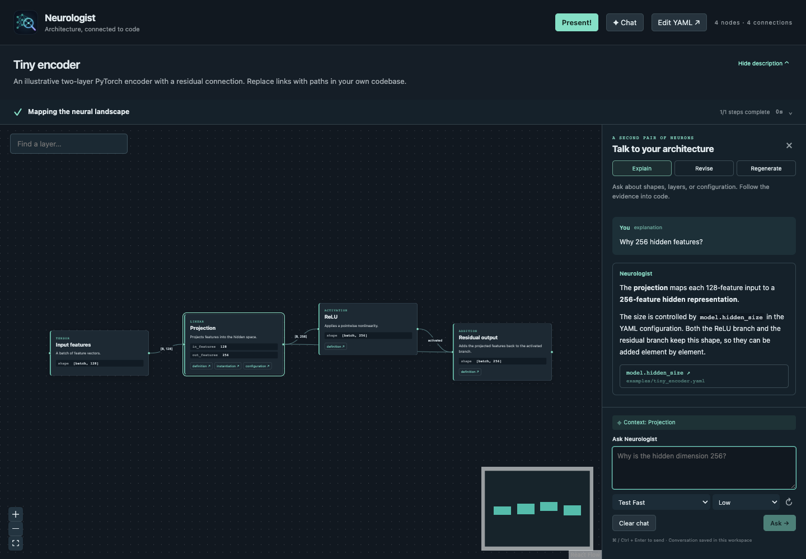
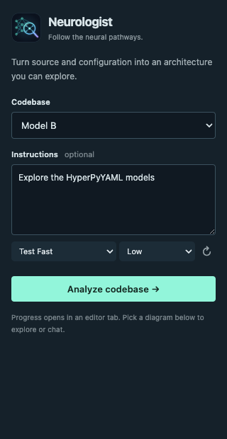
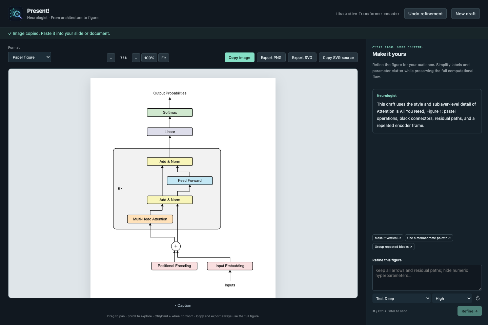

# Neurologist

A VS Code extension that asks Codex to explore a codebase and turns the discovered neural architectures into interactive React Flow graphs. Architecture descriptions stay in your repository as editable YAML `.neuro` files.



*The working graph editor with the included fake Tiny encoder diagram and an illustrative chat response. No model call is needed to open the sample.*

## Open Neurologist in the sidebar

Click the **neural network and magnifying glass icon** in VS Code's left Activity Bar, alongside Explorer and Source Control.

- **Analyze** has an optional **Instructions** field and an **Analyze codebase** button. With multiple workspace folders, choose the codebase first. Clicking Analyze starts exploration in an editor tab with live progress.
- **Diagrams** lists the project's .neuro files, including generated diagrams in .neurologist. Click any diagram to open its interactive graph. The list updates automatically when diagrams are created, changed, renamed, or deleted, and the view toolbar also has a Refresh button. Multiple workspace folders are grouped separately.



Use **Hide description** in a diagram's title area to fold the summary into a compact header. The diagram header contains no Instructions or Regenerate form; use chat to guide regeneration. **Show description** restores the summary. The collapsed state is remembered for that editor, and chat and graph navigation remain available.

## Run locally

Requires Node.js 22 or later, VS Code 1.96 or later, and a [Codex CLI installation](https://developers.openai.com/codex/cli/) signed in with `codex login`.

```sh
npm install
npm run build
```

Open this repository in VS Code and press **F5** using the included local **Run Neurologist** launch configuration. Alternatively run `code --extensionDevelopmentPath=/absolute/path/to/neurologist`. In the Extension Development Host:

1. Open a local codebase folder (or this repository to try the sample).
2. Click **Neurologist** in the Activity Bar, or run **Neurologist: Analyze Codebase** from the Command Palette.
3. Optionally fill in **Instructions**, such as “Focus on the acoustic encoder; include HyperPyYAML dimensions.”
4. Click **Analyze codebase**. Progress is cancellable in VS Code. The **Neurologist** Output channel shows Codex diagnostics.
5. Open generated `.neuro` files in `.neurologist/`. Drag nodes, pan, zoom, search layers, or use the minimap. Click source links to open the current definition or configuration in a code editor beside the graph. The first link creates a split if needed; subsequent source links and Edit YAML reuse the same code editor group, so the diagram does not keep shrinking.

Open `examples/tiny-encoder.neuro` for a small sample without running Codex. `examples/transformer-encoder.neuro` is a richer illustrative encoder with residual paths and repetition metadata. The sample links work when this repository is the workspace root. The sample Python file is illustrative; PyTorch is not required to run the extension.

Use **Edit YAML** to edit a chart. Changes, undo, redo, and external file updates refresh the graph. Use **Chat → Regenerate** to rebuild the current chart from current source/configuration, with your guidance in the chat message. Regeneration replaces the current document as an undoable edit, consolidates your guidance into its Instructions, and refuses to overwrite edits made while Codex was analyzing. Save the document when satisfied. New analyses use unique filenames and save them automatically; each discovered architecture gets its own file. Node dragging is a temporary view adjustment; layout is computed automatically when the document changes.

## Explore with a little spark

Analysis, regeneration, and chat show a live **Exploration activity** widget inspired by Lightacademia. Expand the activity header, then expand individual steps to inspect commands, search results, public field notes, validation, or errors. Step identities stay stable as Codex starts and completes work. The widget shows elapsed time and real activity rather than a simulated percentage. **Cancel exploration** stops the current operation; the VS Code notification is also cancellable. Completed activity follows newly generated diagrams into the editor.

## Talk to your architecture

Open a .neuro graph and use **Chat** in the header. The conversation has three modes:

- **Explain** answers questions about layers, tensor shapes, source code, and HyperPyYAML configuration. It cannot edit the diagram. Source citations open the current code/configuration symbol in the editor.
- **Revise diagram** updates the current .neuro YAML in response to your request. Ask it to expand a block, group repeated layers, fix a connection, or add configuration links. It can ask a clarifying question instead of making a change. Revisions are validated, refresh the graph, and support normal VS Code Undo. Save the file when satisfied.

- **Regenerate** re-reads the current source and configuration, including HyperPyYAML, and rebuilds the current model's diagram. Type your exploration guidance into the chat composer and send it. Existing diagram data is treated as potentially stale; the model scope and useful stable IDs are retained where appropriate. The result is an undoable edit and cannot overwrite changes made while Codex is working. If the scope is unclear, Codex can ask a clarifying question.

The sidebar **Analyze** view and **Neurologist: Analyze Codebase** still provide their optional Instructions field and Analyze button.

Select one or more graph nodes to include them as conversation context. Follow-up questions include the current diagram and recent conversation. Suggested prompts help get started, and Cmd/Ctrl+Enter sends a message. Chats are stored locally in VS Code workspace state per diagram; **Clear chat** removes the saved conversation. The most recent 40 messages are retained, and up to 20 recent messages are included in a request. Each request runs with your existing Codex login/model settings in a read-only sandbox; only the extension applies validated diagram changes. If the document changes while a revision is being generated, the reply cannot overwrite your newer edits.

## Model and reasoning effort

Compact model and effort pickers appear beside the analysis controls in the sidebar and Analyze tab, in architecture chat (Explain, Revise, and Regenerate), and in Present! for drafting and refinement. Choices are remembered per workspace folder and shared across these views. Changing a selector affects the next request; a running request keeps its original choices. Present!'s automatic first draft uses the folder's current selection.

The model list comes from your configured Codex CLI's metadata-only `app-server` → `model/list` interface. No model turn is started to populate it. Choose a model to see its advertised reasoning efforts; changing models clears an effort that the new model does not support. **Codex default** and **Default effort** preserve your existing Codex configuration (or the `neurologist.model` / `neurologist.reasoningEffort` settings). **↻** refreshes the catalog. If discovery is unavailable, defaults still work and **Custom model…** accepts an explicit model ID. Custom models without advertised metadata use the configured default effort. See the [official Codex app-server documentation](https://learn.chatgpt.com/docs/app-server#models) for the discovery protocol.

## Present! — figures for papers and slides

Click **Present!** in a diagram's header, choose **Neurologist: Present!** from the Command Palette, or use the presentation action beside a diagram in the sidebar. A separate editor tab opens and Codex automatically creates a first draft from the current YAML using the **style and level of structural detail of Figure 1 in [Attention Is All You Need](https://arxiv.org/pdf/1706.03762#page=3)** (Vaswani et al., 2017). Meaningful sublayers, residual connections, input/embedding processing, output heads, and repetition counts stay visible where the source architecture supports them. Numeric hyperparameter clutter, file paths, and training plumbing are omitted. Simplification preserves the computational graph: main data flow, branches, merges, conditioning, and residual paths must remain explicit arrow edges. Multi-block figures with isolated blocks are rejected. Missing connections are restored only when they follow unambiguously from YAML provenance; otherwise Codex gets one repair attempt. Existing saved drafts with missing arrows are repaired on reopening where provenance permits, or replaced with a fresh draft when it does not.

After the draft appears, refinement chat opens beside it. For example:

- “Group the repeated encoder blocks.”
- “Make the diagram vertical and use a monochrome palette.”
- “Remove the title and add only the input/output shapes.”
- “Simplify this for a PowerPoint slide.”

Drag with the left mouse button to pan the figure. The preview also scrolls horizontally and vertically at its native size. Use **+ / −**, **100%**, or **Fit** to adjust zoom, or hold **Ctrl/Cmd** while scrolling over the image. Copying and exporting always use the full figure, independently of the preview zoom or scroll position.

Use **Format** to request a paper or PowerPoint version. **Undo refinement** restores the previous figure without another model call, while **New draft** starts again from the latest YAML. The figure and its recent conversation are saved locally in VS Code workspace state. Reopening Present! returns to that draft. Presentation changes do not modify the original .neuro file.



*An illustrative encoder in the reference-inspired default style, with a six-layer module frame. The screenshot uses a scripted sample response; it is not a reproduction of the paper’s figure.*

- **Copy image** copies the figure as a PNG image for pasting into a slide or document.
- **Export PNG** saves a raster image rendered at up to 2× the figure's native dimensions.
- **Export SVG** saves a self-contained vector image that stays sharp when resized. This is the preferred export for papers and later editing, and can be inserted into PowerPoint as an SVG image.
- **Copy SVG source** copies the vector markup as text.

The default preview and exports use the reference figure’s visual conventions: bottom-to-top flow, a white background, compact sans-serif labels, black outlines and orthogonal arrowed connectors, pastel role colors, circled additions, and light-gray frames around repeated stacks with counts such as 6×. Attention is orange, feed-forward blocks blue, normalization yellow, embeddings pink, projections lavender, and output activations green. Teal, blue, and monochrome palettes remain available through refinement requests. Captions appear in a **Caption** disclosure below the preview, collapsed by default, and are separate from the exported image. The generation pipeline is **YAML → Codex graph specification → ELK.js layout → SVG**. Codex chooses semantic blocks, grouping, labels, and flow direction. [ELK.js](https://github.com/kieler/elkjs) uses its layered algorithm to place blocks and repeated-module frames, reserve label space, and route orthogonal arrows, including residual and cross-group connections. The extension serializes ELK's positions and routed edge sections into SVG; Codex does not supply SVG, coordinates, or hand-routed paths. Layout runs in the extension host, and the preview, clipboard, and exports share the same rendered SVG. Reopened saved drafts are laid out with ELK automatically without a model call. Model-provided SVG/HTML is never executed. Codex is explicitly told to match the reference’s sublayer-level detail rather than produce a three-to-eight-block summary. If the YAML collapses a module too coarsely, Codex is instructed to inspect linked definitions and configuration read-only to recover supported sublayers. The reference controls visual language and granularity; it does not introduce Transformer components into other model families. Review the result against the YAML. Existing saved drafts retain their styling; choose **New draft** to regenerate them with the new default.

Image clipboard support uses the native clipboard on macOS and Windows. Linux needs `wl-copy` or `xclip`; if an image copy is unavailable, use PNG/SVG export. Each draft/refinement uses your existing Codex model and account settings, with the same cancellable activity reporting as analysis.

The Present! tests cover structured initial drafts and refinements, graph/source validation, escaped SVG text, ELK placement and orthogonal routing across all flow directions, group containment, residual/cross-group edge attachment, block overlap and edge obstruction checks, cycles and parallel edges, vertical/monochrome rendering, PNG input bounds, native clipboard command construction, and browser image rasterization/copy/export requests. `npm run test:present-host` checks automatic drafting and tab reuse in an isolated VS Code instance using a mock CLI. It does not overwrite the system clipboard or make a paid model call.


## Source anchors

Links contain **workspace-relative file paths and symbol names**, with no saved line numbers. Neurologist first resolves YAML/HyperPyYAML dotted key paths or the language extension's current document symbols, then falls back to declaration/assignment matching. Python/Pylance or the appropriate language extension improves qualified symbol resolution. If a fallback finds multiple candidates, you choose one; missing symbols open the file with a warning. File/symbol renames and major refactors require regeneration. Nested YAML mappings are supported; sequence element anchors are not yet supported.

```yaml
version: 1
title: Encoder
summary: A feature projection.
instructions: Show the projection dimensions.
nodes:
  - id: projection
    label: Projection
    kind: Linear
    description: Projects input features to the hidden dimension.
    parameters:
      - { name: in_features, value: '128' }
      - { name: out_features, value: '256' }
    sources:
      - { kind: definition, file: models/encoder.py, symbol: Encoder }
      - { kind: instantiation, file: models/encoder.py, symbol: Encoder.projection }
      - { kind: configuration, file: config/train.yaml, symbol: model.hidden_size }
edges: []
```

All displayed fields are explicit. `parameters` and `sources` may be empty arrays. Edges contain `id`, `source`, `target`, and `label` strings. IDs must be unique and edge endpoints must exist. Multiple inputs, branches, residual paths, and cycles are supported. Values can be symbolic strings where dimensions depend on runtime inputs. Each file holds one architecture; one analysis can return multiple files. Model output is schema-validated and checked for graph consistency before any chart is written.

## Settings

| Setting | Default | Purpose |
| --- | --- | --- |
| `neurologist.codexPath` | `codex` | Codex executable path; machine setting, not a shell command. Auto-detects PATH and common install locations (including `~/.local/bin` and Homebrew). You can override this with an absolute or `~/` path. |
| `neurologist.model` | empty | Optional model override; otherwise uses your Codex configuration. |
| `neurologist.outputDirectory` | `.neurologist` | Workspace-relative directory for new charts. |

Analysis uses [Codex non-interactive mode](https://developers.openai.com/codex/noninteractive/), a read-only sandbox, a structured output schema, and your existing Codex authentication. It does not need a separately configured API key. Codex account usage and configured provider billing still apply. The workspace is sent to your configured Codex provider as needed for analysis. This extension does not execute model code or load HyperPyYAML objects. Analysis requires Workspace Trust. Source/output paths are restricted to the workspace, including symlink targets. Graph rendering is local and webview scripts use a content security policy.

Generated charts are an inferred architectural view, not a runtime trace. Review connections and dimensions against the linked source. Large networks are prompted to group repeated blocks; validation caps a chart at 500 nodes and 2,000 edges. Remote/virtual workspaces are not supported in this initial version. No live file watcher reruns Codex automatically.

## Development and packaging

```sh
npm run check
npm test
npm run build
npm run test:host
npm run test:present-host
npm run test:ui
npm run package
```

`npm run watch` rebuilds bundles during development. `npm run package` creates an installable `.vsix`; install it with **Extensions: Install from VSIX**. Runtime dependencies are bundled, and source files and `node_modules` are excluded from the package. The tests exercise graph validation, source fallback stability after line insertions, Codex process invocation/cancellation/failures, streamed activity, selected-node conversation context, explanation-mode edit rejection, and structured chat output with a local mock CLI. The host test also verifies revision Undo and rejection of stale edits, while browser tests cover expandable progress, cancellation, both chat modes, source citation messages, safe Markdown, description collapse/expand, and the sidebar Instructions/workspace controls. The host test verifies diagram discovery, file-watcher refresh, and opening diagrams from the sidebar. They do not make paid model calls.

The host smoke test opens and closes an isolated VS Code instance using a temporary profile. On other installations, set `VSCODE_EXECUTABLE` to the VS Code application executable. The UI smoke test needs Chromium; set `CHROMIUM_EXECUTABLE` to its executable path. Neither smoke test calls a model. The included default paths target this macOS development environment.

If an older version reports `spawn codex ENOENT`, set `neurologist.codexPath` in VS Code **User Settings** to the full CLI executable path. Version 0.1.1 adds discovery for GUI-launched VS Code, including `~/.local/bin/codex`, and reports actionable errors for missing executables. The resolved path is logged in the Neurologist Output channel.

The logo is maintained as an SVG in `assets/neurologist.svg`; `npm run branding` exports the extension icon PNG using Chromium. To refresh the README screenshots from the sample UI, run `UPDATE_SCREENSHOT=1 npm run test:ui`. Screenshots use the included example diagram and scripted chat content, with no model call.
